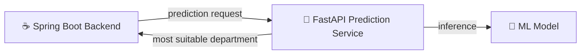

 

**Java · Spring Boot · React · Flutter · Python · FastAPI · SQL · AI Integration**

I build practical software across the stack: backend APIs and relational data models, web and mobile interfaces, and Python ML services wired into real applications.

  
  
  <!-- Optional: add your portfolio once it is live
  
  -->

---

## What I Build

<table width="100%">
  <tr>
    <th width="50%" align="left">⚙️ &nbsp;Backend &amp; APIs</th>
    <th width="50%" align="left">🌐 &nbsp;Web Interfaces</th>
  </tr>
  <tr>
    <td valign="top">
      Java, Spring Boot, and FastAPI services with clean REST design and solid relational data models.
       &nbsp;
    </td>
    <td valign="top">
      React front ends connected to backend APIs, built for clear and usable experiences.
       &nbsp;
    </td>
  </tr>
  <tr>
    <th width="50%" align="left">📱 &nbsp;Mobile Apps</th>
    <th width="50%" align="left">🤖 &nbsp;AI &amp; ML Integration</th>
  </tr>
  <tr>
    <td valign="top">
      Flutter applications with practical, user-focused features.
       &nbsp;
    </td>
    <td valign="top">
      External AI services & Python ML models served through APIs and plugged into backend workflows to solve real user problems.
       &nbsp;
    </td>
  </tr>
</table>

## Tech Stack

<table>
  <tr>
    <td width="170"><b>Languages</b></td>
    <td></td>
  </tr>
  <tr>
    <td><b>Backend</b></td>
    <td></td>
  </tr>
  <tr>
    <td><b>Frontend &amp; Mobile</b></td>
    <td></td>
  </tr>
  <tr>
    <td><b>Data &amp; ML</b></td>
    <td>
      
      
    </td>
  </tr>
  <tr>
    <td><b>Tools</b></td>
    <td></td>
  </tr>
</table>

  
  
  
  

## Featured Projects

<table>
  <tr>
    <td width="33%" valign="top">
      <h3><a href="https://github.com/Abzoty/GP-Backend">Covalent · Backend</a></h3>
      
Backend for a student-focused platform that makes peer learning easier through shared knowledge, study resources, collaboration, and AI-assisted support. Built around REST API design and structured data management.

      

        
        
      

      
<a href="https://github.com/Abzoty/GP-Backend">View repository →</a>

    </td>
    <td width="33%" valign="top">
      <h3><a href="https://github.com/Abzoty/ml-prediction-service">Covalent · ML Service</a></h3>
      
Python microservice that serves a trained ML model to the Covalent backend, returning the most suitable department as prediction data. Ships with a test suite and a backend-compatibility check.

      <!-- Add real numbers here for extra impact, e.g. model accuracy, dataset size, response time -->
      

        
        
        
      

      
<a href="https://github.com/Abzoty/ml-prediction-service">View repository →</a>

    </td>
    <td width="33%" valign="top">
      <h3><a href="https://github.com/Abzoty/heal_meals_flutter">HealMeals</a></h3>
      
Flutter recipe application that helps people navigate food choices with allergies and medical conditions in mind, with a focus on user-centered mobile features.

      

        
        
      

      
<a href="https://github.com/Abzoty/heal_meals_flutter">View repository →</a>

    </td>
  </tr>
</table>

### Covalent · How the Services Connect

## Experience and Education

**💼 EgronX — Software Development Trainee** · *3-month internship*

- Contributed to mobile application development and backend implementation.
- Applied database design and maintenance, version control, and GitHub branching workflows in a team setting.
- Collaborated across teams in planning sessions and meetings, strengthening communication and coordination.

**🎓 Cairo University** — Faculty of Computers and Artificial Intelligence · Bachelor's degree · **GPA: 3.46**

## GitHub at a Glance

  
  
   
  

 

**Building useful software with thoughtful engineering and practical AI integration.**

